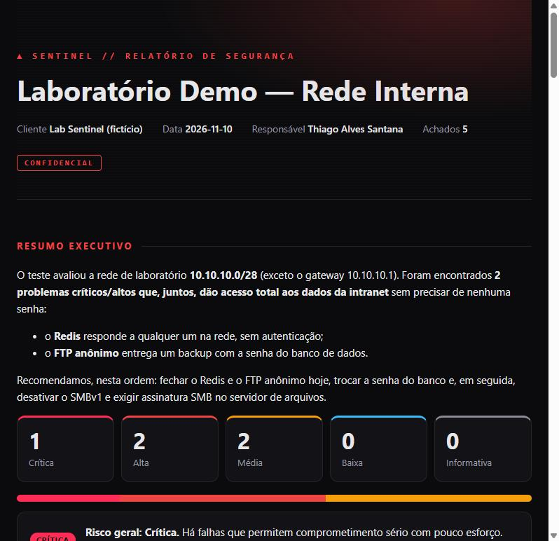
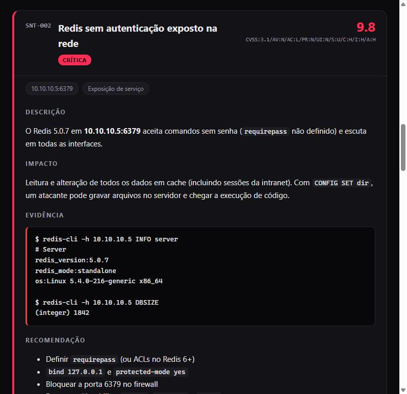

<div align="center">

# ▲ Sentinel

**Uma skill que transforma o Claude num operador de cibersegurança — ético, metódico e que entrega relatório.**

Pentest autorizado, CTF, bug bounty, auditoria do seu próprio site/código e blue team.
Com **portão de escopo obrigatório**, **registro de cada ação**, achados com **CVSS 3.1** e **relatório profissional** no final.

[](https://github.com/thiagoalves0707/sentinel/actions/workflows/ci.yml)


### [▶ Ver um relatório de exemplo](https://thiagoalves0707.github.io/sentinel/examples/lab-demo/engagement/report.html)



</div>

---

## 🤔 Por que isso existe

Dá pra pedir pra uma IA "hackear um site". O problema é **como**: sem escopo, sem registro, sem limite,
sem relatório. Um pentester de verdade trabalha diferente — e é isso que o Sentinel ensina o Claude a fazer:

| Sem o Sentinel | Com o Sentinel |
|---|---|
| sai escaneando o que aparecer | **só age dentro do escopo autorizado** — os scripts se recusam a tocar outro alvo |
| comandos soltos no chat | **cada ação registrada** com horário, alvo e resultado |
| "achei uma falha grave!" | **confirmado × suspeita**, nota **CVSS 3.1** calculada, sem exagero |
| explicação genérica | **evidência reproduzível + correção concreta** para a sua stack |
| fim da conversa | **relatório HTML profissional**, pronto pra entregar ou imprimir em PDF |

## 🧭 O que acontece quando você pede "audita meu site"

1. **Escopo primeiro.** O Claude pergunta se o alvo é seu (ou se você tem autorização), o que pode ser
   testado e o que fica de fora — e registra. Sem isso, as ferramentas não rodam.
2. **Varredura automática.** Ele roda sozinho a auditoria do site (cabeçalhos de segurança, cookies, HTTPS/TLS,
   arquivos sensíveis expostos como `.git` e `.env`) e, se você tiver o código, a caça a senhas e chaves vazadas.
3. **Investigação, pensando como atacante.** Mapeia páginas, login, formulários e API, e testa as falhas mais
   comuns do OWASP Top 10 (injeção, controle de acesso, autenticação…) com **testes leves, que só provam que a
   falha existe**. Se você tiver ferramentas como `nmap` e `ffuf` (no Kali, por exemplo), ele as usa e vai mais fundo.
4. **Pergunta antes do que é pesado.** Upload de arquivo, várias tentativas de senha, rodar um exploit: ele
   explica o que vai fazer e espera o seu ok.
5. **Relatório no final.** Cada falha com nota de gravidade (CVSS 3.1), evidência e **como corrigir** — e, sendo
   o sistema seu, a correção já vem pronta para a sua plataforma (nginx, Vercel, Next.js…).

### ✅ O que ele faz × ❌ o que ele não faz

| ✅ Faz | ❌ Não faz |
|---|---|
| Automatiza o trabalho repetitivo de recon e auditoria | **Não garante achar todas as falhas** — nenhuma ferramenta (nem pentester humano) garante |
| Cobre bem as falhas comuns e de configuração | Falhas muito específicas da lógica do seu negócio dependem de investigar junto com você |
| Investiga junto com você e explica o raciocínio | **Não ataca sistemas de terceiros**: alvo fora do escopo é bloqueado |
| Separa falha **confirmada** de **suspeita** | Não derruba nem estraga nada: sem sobrecarga (DoS), sem apagar ou alterar dados |
| Entrega relatório profissional com correções | Não substitui um pentest formal quando há exigência legal/contratual de um |

Pense nele como um **pentester assistente**: faz a parte chata sozinho, investiga com você e entrega o relatório.

## ✨ O que vem dentro

| Ferramenta | O que faz |
|---|---|
| 🔐 **`scope.py`** | Portão de autorização. Escopo com IPs, redes CIDR, faixas, domínios e curingas (`*.empresa.com`), exclusões que **sempre vencem**, janela de datas e regras de engajamento. Confere até para onde o DNS aponta. |
| 🌐 **`web_audit.py`** | Auditoria **passiva** de site, com nota de A+ a F: HTTPS e redirecionamento, HSTS, CSP, clickjacking, cookies (`Secure`/`HttpOnly`/`SameSite`), CORS, versão de software exposta, certificado e **TLS 1.0/1.1 obsoletos**. Com `--probe`, procura `.git`, `.env`, `phpinfo` e `server-status` expostos. |
| 🛰️ **`nmap_parse.py`** | Lê o XML do nmap e devolve um mapa de ataque: serviços, versões, **riscos** (FTP anônimo, SMBv1, Redis/Mongo/Docker API expostos…), alerta de host fora do escopo e **o próximo comando de enumeração** para cada serviço. |
| 🔑 **`secrets_scan.py`** | Caça senhas e chaves esquecidas (AWS, GitHub, Google, OpenAI, Anthropic, Stripe, Slack, JWT, chaves privadas…) na pasta **e em todo o histórico do git**. Valores sempre mascarados. Entende `.gitignore`. Sai com erro em CI. |
| 📊 **`cvss.py`** | Calculadora CVSS v3.1 fiel à especificação do FIRST (com o arredondamento oficial). |
| 📄 **`report.py`** | Registra, confirma e descarta achados; gera `report.html` + `report.md` com capa, resumo executivo, escopo, metodologia, achados detalhados e o log de atividades. |
| 📚 **`references/`** | Metodologia por serviço, checklist web OWASP Top 10 com **prova mínima segura** para cada teste, privesc Linux/Windows/AD, hardening, análise de logs, resposta a incidente e guia de escrita de relatório. |

Tudo em **Python puro, sem dependências** — roda no Kali, no Windows, no Mac ou num container.

<div align="center">

</div>

## 🚀 Instalação (Claude Code)

```bash
git clone https://github.com/thiagoalves0707/sentinel ~/.claude/skills/sentinel
```
No Windows (PowerShell): `git clone https://github.com/thiagoalves0707/sentinel $HOME\.claude\skills\sentinel`

Pronto. Peça em português mesmo:

> *"Vamos fazer a máquina Lame do Hack The Box, IP 10.10.10.3"*
> *"Audita a segurança do meu site thiago.dev"*
> *"Vê se eu vazei alguma chave no meu repositório antes de publicar"*
> *"Recebi esse log do nginx, alguém tentou invadir?"*

O Claude vai primeiro registrar o escopo e a autorização — e só depois começar.

## 🎮 Como funciona na prática

```console
$ python scripts/scope.py init --name "HTB - Lame" --mode ctf --in 10.10.10.3 --auth "Hack The Box"
✔ engagement criado em ./engagement

$ python scripts/scope.py check 10.10.10.3 google.com
✔ DENTRO 10.10.10.3  dentro do escopo (10.10.10.3)
✖ FORA   google.com  não está na lista de escopo

$ python scripts/nmap_parse.py nmap.xml --add-findings
■ 10.10.10.5 (web01.lab.local)  Linux 5.4
  21/tcp     ftp       vsftpd 3.0.3
  6379/tcp   redis     Redis key-value store 5.0.7
  ▲ Alta  FTP aceita login anônimo (porta 21)
  ▲ Alta  Redis exposto (porta 6379)
  próximos passos:
    → 21/ftp: ftp 10.10.10.5 (testar login anonymous) · nmap --script ftp-anon,ftp-syst -p21 10.10.10.5
    → 6379/redis: redis-cli -h 10.10.10.5 INFO  (só leitura)

$ python scripts/report.py set SNT-002 --status confirmado --cvss "CVSS:3.1/AV:N/AC:L/PR:N/UI:N/S:U/C:H/I:H/A:H"
✔ SNT-002 Crítica  Redis sem autenticação exposto na rede

$ python scripts/report.py build
✔ engagement/report.html
```

### Modos

| Modo | Para quê |
|---|---|
| `ctf` | Hack The Box, TryHackMe, VulnHub, laboratório — ensina o caminho passo a passo |
| `pentest` | trabalho autorizado por contrato, com metodologia completa e relatório formal |
| `bugbounty` | as regras do programa viram o escopo |
| `own` | seu site, servidor ou código — achou o problema, já mostra o conserto |
| `blue` | defesa: hardening, análise de logs, resposta a incidente |

## 🛡️ Ética embutida, não opcional

- Sem escopo registrado, os scripts ativos **não rodam**. Alvo fora do escopo é **bloqueado e registrado** — nenhum pacote sai.
- Exclusões sempre vencem: proibir `admin.empresa.com` também proíbe `x.admin.empresa.com`, e um domínio que **resolve** para um IP proibido é bloqueado.
- Sem negação de serviço, sem ação destrutiva, limite de requisições por segundo, **prova mínima** para cada vulnerabilidade.
- Credenciais encontradas ficam em `engagement/loot/`, fora do git, e aparecem mascaradas no relatório.

> ⚠️ Use apenas em sistemas seus, em laboratórios/CTFs ou com **autorização por escrito** do responsável.
> Acessar sistemas sem autorização é crime (no Brasil, Lei 12.737/2012 — art. 154-A do Código Penal).

## 🔧 Usando sem o Claude

Os scripts funcionam sozinhos. Um bom começo é proteger seus próprios repositórios:

```bash
python scripts/secrets_scan.py ~/meu-projeto --git
```

Ou no CI do seu projeto (barra o merge se aparecer segredo):

```yaml
- run: |
    git clone --depth 1 https://github.com/thiagoalves0707/sentinel /tmp/sentinel
    python /tmp/sentinel/scripts/secrets_scan.py . --git
```

## 🧪 Testes

```bash
python -m unittest discover -s tests -v
```
Cobrem a lógica de escopo (CIDR, faixas, IPv6, curingas, exclusões, janela de tempo), as notas CVSS contra
valores oficiais, o scanner de segredos (detecta reais, ignora exemplos e código) e o escape de HTML do
relatório. O CI roda em Linux e Windows, Python 3.9 e 3.13 — e passa o próprio `secrets_scan` no repositório.

## 📁 Estrutura

```
SKILL.md                 instruções que o Claude segue (regras, modos, workflow)
scripts/
├── _common.py           escopo, log, achados, cores — compartilhado
├── scope.py             portão de autorização
├── web_audit.py         auditoria web passiva
├── nmap_parse.py        interpretação do nmap
├── secrets_scan.py      caça a segredos
├── cvss.py              calculadora CVSS 3.1
└── report.py            achados e relatório
references/              metodologia, OWASP, privesc, blue team, relatório
examples/lab-demo/       engagement completo de exemplo (laboratório fictício)
tests/                   testes unitários
```

---

<div align="center">

Feito por **[Thiago Alves Santana](https://github.com/thiagoalves0707)** · Cybersecurity & Desenvolvimento · Se curtiu, deixa uma ⭐

</div>
